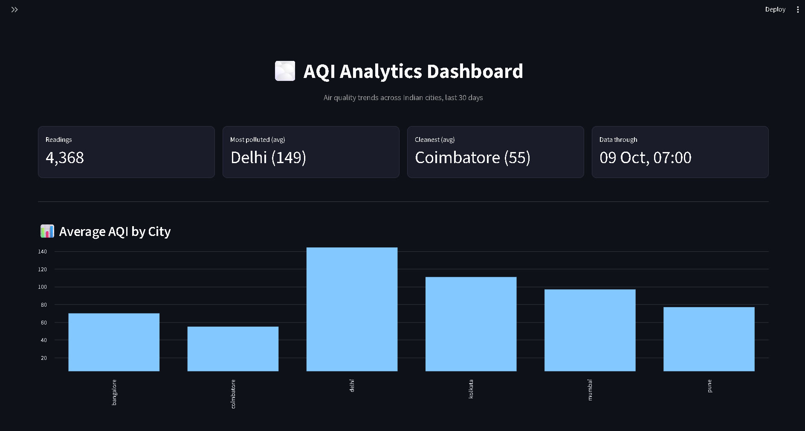
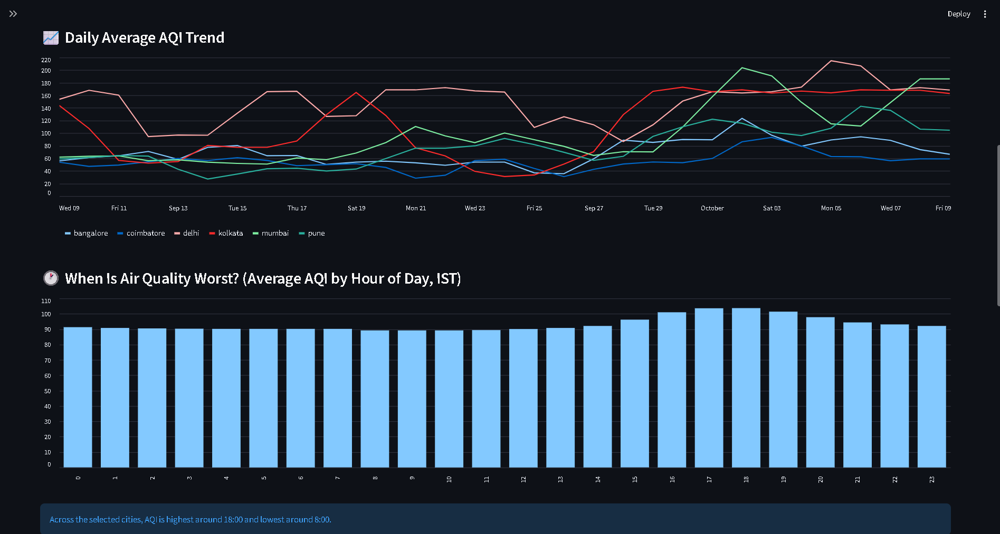
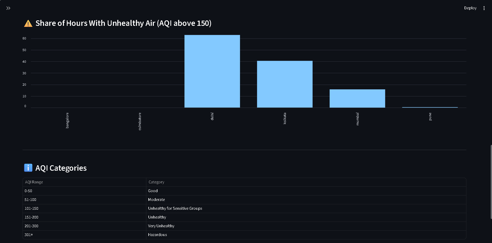
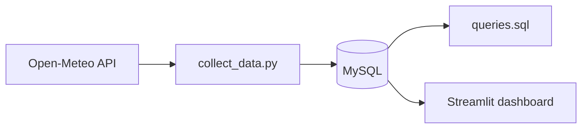

# AQI Analytics

### Hourly Air Quality for 15 cities, stored in MySQL and explored with SQL and a dashboard

[](https://www.python.org/)
[](https://www.mysql.com/)
[](https://streamlit.io/)
[](https://pandas.pydata.org/)

I wanted a project where I collect the data myself instead of downloading a ready-made CSV. This one pulls hourly air quality (US AQI) for 15 cities, Keeps 30 days of it in MySQL, and then I try to Answer a few questions: Which cities have the worst air, what time of day is the worst And is it Getting Better or worse.

Cities: Delhi, Mumbai, Kolkata, Chennai, Bangalore, Hyderabad, Pune, Ahmedabad, Jaipur, Lucknow, Patna, Bhopal, Chandigarh, Coimbatore and Aurangabad.







*Screenshots show six cities (Delhi, Kolkata, Mumbai, Pune, Bangalore, Coimbatore). The Numbers in "What I found" are across all 15.*

## What I found

The Data covers the 30 days up to 9 Oct 2026, About 10,900 Hourly Readings.

- **Delhi is far ahead of the rest.** About 63% of its hours had an AQI above 150. Kolkata was next at 40% and Chandigarh at 38%. Five cities (Aurangabad, Bangalore, Bhopal, Coimbatore, Hyderabad) never crossed 150.
- **The 30-day average hides what's happening now.** Delhi's 30-day average is 149, but the last 7 days averaged 181.
- **The last week was worse than the week before in 13 of the 15 cities.** The biggest jumps were Mumbai (95 to 159) and Delhi (125 to 181). Only Jaipur and Chennai got better.
- **Evenings are a little worse.** Averaged over all cities, AQI is highest around 6 pm (105) and lowest around 8 am (89).

The SQL behind all of this is in [queries.sql](queries.sql).

## A problem I ran into

My first version used a station-based API. After a week of collecting every day, 14 of my 15 cities showed the exact same AQI value on every single day. Air quality doesn't behave like that, so I looked at the timestamps the API sends back. Those stations hadn't updated in months, a few not since 2021. My script was saving the date I collected the data, not the time it was measured Which is why I didn't notice Earlier.

I threw that data away and switched to Open-Meteo's air quality API. Now I save the actual measurement time, and there's a unique key on (city, time), so running the script again never creates duplicates and a missed day gets filled in next time.

## How it works



`collect_data.py` fetches the last 30 days of hourly AQI for each city and saves only the hours it doesn't have yet. The dashboard reads from MySQL and shows average AQI per city, the daily trend, AQI by hour of the day, and how many hours were unhealthy. You can filter by city and download the data as CSV.

## Tech

Python, Pandas, MySQL, Streamlit, Requests

## Project structure

```
AQIAnalytics/
├── config.py          # cities with coordinates, DB settings (password is in .env)
├── database.py        # MySQL helpers - save, fetch, clear
├── collect_data.py    # Pulls hourly AQI from the API into MySQL
├── dashboard.py       # the Streamlit app
├── queries.sql        # the SQL analysis
└── requirements.txt
```

## Running it

```bash
python -m venv venv
venv\Scripts\activate
pip install -r requirements.txt
```

Put your MySQL password in a `.env` file:

```
DB_PASSWORD=your_mysql_password
```

Create the database and table:

```sql
CREATE DATABASE aqi_analytics_db;
USE aqi_analytics_db;

CREATE TABLE aqi_readings (
    id INT AUTO_INCREMENT PRIMARY KEY,
    city VARCHAR(50),
    aqi INT,
    measured_at DATETIME,
    UNIQUE KEY uniq_city_time (city, measured_at)
);
```

Then:

```bash
python collect_data.py        # fetch the data (safe to run again)
streamlit run dashboard.py    # open the dashboard
```

## Things to keep in mind

- The data is model-based, not from ground stations. Open-Meteo's air quality data comes from the CAMS global model at roughly 45 km resolution, so it shows regional patterns, not what one monitor on one street would read.
- I only have 30 days so the "last 7 days vs the 7 before" comparison covers a short window. It's not a Long-term trend.
- The evening-peak pattern is what this dataset shows. I haven't checked it against Real Station data.

Air quality data: [Open-Meteo](https://open-meteo.com/) (CAMS ENSEMBLE data provider).

## Author

**Abhay Marwade**

Aspiring Data Analyst

[GitHub](https://github.com/ABHAYMARWADE2004)